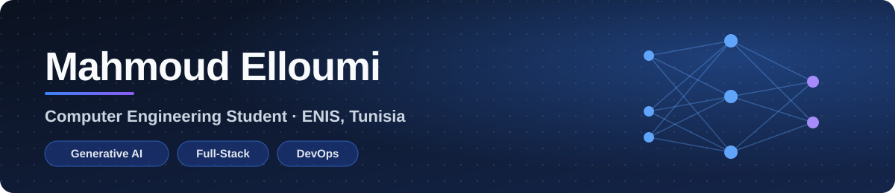

<!-- Profile README: copy this file AND the assets/ folder into the repo github.com/mahmoudelloumi/mahmoudelloumi -->

  

  
  
  

## 👋 Hi, I'm Mahmoud

I'm a computer engineering student at **ENIS** (Sfax, Tunisia). I like taking a real business problem, an after-sales team buried in requests or a company retyping invoices by hand, and turning it into an application that people actually use, with **generative AI** where it really helps and **data & BI** to measure the result.

I care about the whole chain: the data, the backend, the interface, the tests and the deployment.

## 🧰 What I can do

- **AI assistants on local LLMs**: assistants that answer from a company's own data with Ollama, so nothing leaves the company
- **Document AI**: OCR and structured extraction from invoices, quotes and purchase orders with Mistral AI
- **Workflow automation**: n8n pipelines that classify, notify and export without manual work
- **Full-stack apps**: Spring Boot and FastAPI backends, React and Angular front ends, secured with JWT and 2FA
- **Event-driven systems**: real-time pipelines with Apache Kafka and MQTT
- **Data analysis & BI**: cleaning and analyzing data with Python and pandas, then Power BI dashboards (Power Query, DAX) that business teams can read
- **Machine learning**: anomaly detection, churn prediction, self-supervised vision models in PyTorch
- **DevOps & software quality**: Docker, Git, TDD, SonarQube, Scrum

## 💡 What drives me

- **Real needs first**: technology is worth it when it saves someone time
- **Reliable results**: test, measure, compare, then keep what actually works
- **Learning by building**: most of what I know, I learned by shipping a project
- **Teamwork**: most of my projects were built in teams of 2 or 3

## 📌 Right now

- 🔭 Building **EVA-Guard**, agentic detection of attacks on an Ethereum node, and **Smart Surveillance**, Fog & Cloud video surveillance with 250+ automated tests
- 🎯 Looking for a **final-year engineering internship (PFE)** in generative AI, data & BI, full-stack or DevOps

## 🚀 Things I've built

<table>
  <tr>
    <td width="50%" valign="top">
      <h3><a href="https://github.com/mahmoudelloumi/Sparky_V2">SPARKY</a></h3>
      Reads, classifies and extracts data from invoices, quotes and purchase orders with Mistral AI: <b>3 to 8 s per document</b> instead of 120 to 180 s for our first prototype. My part: the n8n workflow and the Angular front end.  
      <code>Angular</code> <code>FastAPI</code> <code>Mistral AI</code> <code>n8n</code> <code>Docker</code>
    </td>
    <td width="50%" valign="top">
      <h3><a href="https://github.com/mahmoudelloumi/SAV">SAV</a> · internship at IDSOFT</h3>
      After-sales service platform for customers, technicians and managers, with <b>6 generative AI features</b> running locally on Ollama.  
      <code>React</code> <code>Spring Boot</code> <code>PostgreSQL</code> <code>Ollama</code> <code>JWT / TOTP</code>
    </td>
  </tr>
  <tr>
    <td width="50%" valign="top">
      <h3><a href="https://github.com/mahmoudelloumi/BankingTransaction">TransactFlow</a></h3>
      Real-time banking transactions on Kafka: <b>4 topics, 4 consumer groups</b>, fraud scoring and a live dashboard.  
      <code>Java</code> <code>Apache Kafka</code> <code>REST</code>
    </td>
    <td width="50%" valign="top">
      <h3><a href="https://github.com/mahmoudelloumi/EVA-Guard">EVA-Guard</a> · <i>in progress</i></h3>
      ML spots an anomaly on an Ethereum node, an LLM with RAG proposes a hypothesis, agents gather evidence, a fixed rule confirms the attack.  
      <code>Python</code> <code>Geth</code> <code>Docker</code> <code>LangGraph</code>
    </td>
  </tr>
  <tr>
    <td width="50%" valign="top">
      <h3><a href="https://github.com/mahmoudelloumi/ML2-Projet">I-JEPA from scratch</a></h3>
      Meta AI's self-supervised vision model rebuilt in PyTorch: Vision Transformer, EMA target encoder, multi-block masking and a Streamlit demo.  
      <code>PyTorch</code> <code>ViT</code> <code>Streamlit</code>
    </td>
    <td width="50%" valign="top">
      <h3><a href="https://mahmoud-elloumi.vercel.app/#projet-anomalies">Sales anomaly detection</a></h3>
      Flags and explains unusual sales in <b>121,000+ transactions</b>: quality rules, robust z-score and Isolation Forest. <b>90 / 90</b> injected errors found, plus a 6-page Power BI report.  
      <code>Python</code> <code>scikit-learn</code> <code>Power BI</code>
    </td>
  </tr>
  <tr>
    <td width="50%" valign="top">
      <h3><a href="https://github.com/mahmoudelloumi/ML-projet">Customer churn prediction</a></h3>
      scikit-learn pipeline on 52 features (SMOTE, GridSearchCV) with a Flask dashboard of at-risk customers.  
      <code>Python</code> <code>scikit-learn</code> <code>Flask</code>
    </td>
    <td width="50%" valign="top">
      <h3><a href="https://mahmoud-elloumi.vercel.app/#projet-iot">Industrial fire detection (IoT)</a></h3>
      ESP32 sensor nodes, a 6LoWPAN mesh and an Edge gateway that raises local alarms even without internet, then reports to AWS IoT.  
      <code>ESP32</code> <code>MQTT</code> <code>AWS IoT</code>
    </td>
  </tr>
</table>

<a href="https://mahmoud-elloumi.vercel.app/"><b>More on my portfolio →</b></a> internships, case studies and screenshots

## 🛠️ Tools I use

   
  

<b>Also:</b> Power BI · Power Query · DAX · pandas · Ollama · Mistral AI · n8n · LangGraph · MQTT · SonarQube · Scrum

## 🤝 Let's work together

Have an internship, a project that needs AI or automation, or just want to talk tech? Write to me at **mahmoudelloumi@gmail.com**. I reply in Arabic, French or English.
